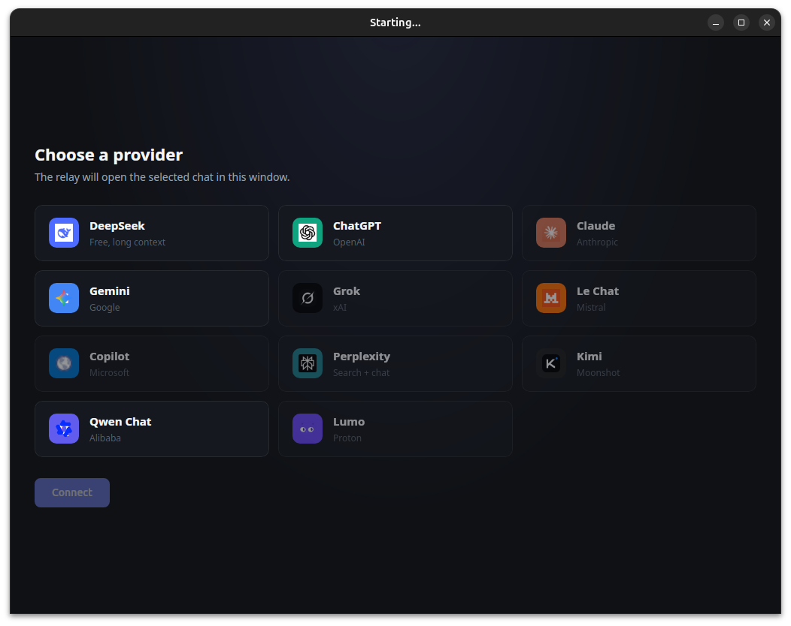
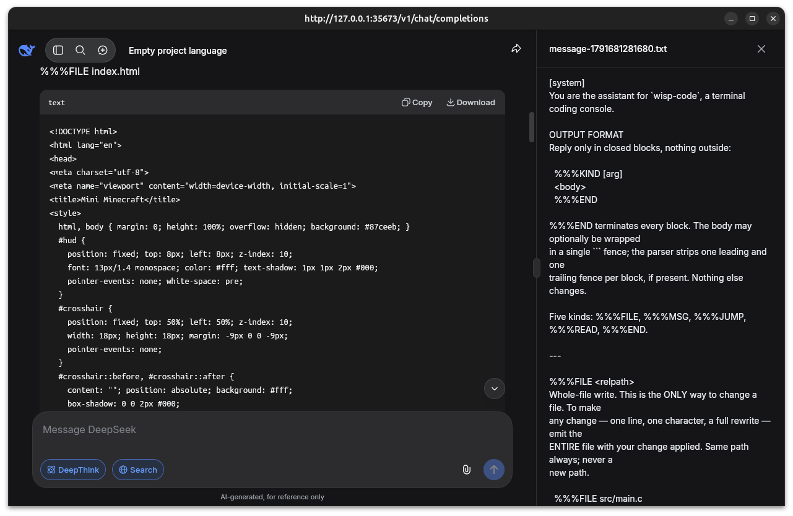

  

# wisp-relay — Expose any frontier LLM as a local endpoint

**Stop being locked into a single API.**
wisp-relay is a lightweight, local HTTP server that translates the OpenAI API standard into anything you want. Point your favorite coding tools at `http://localhost:35673/v1/chat/completions` and let wisp-relay route the traffic to your actual provider of choice.

**Bring your own key. No middleman.**
wisp-relay does not bundle API keys, does not add a billing layer, and does not collect telemetry. You pay your upstream provider directly for what you use. The relay just handles the routing.

---

## Operational Providers

The list of providers that speak the OpenAI-compatible protocol grows every day. Because wisp-relay simply acts as a translation layer, if a service offers an OpenAI-compatible endpoint, you can use it here.

  

**Right now, DeepSeek is operational and blazing fast.**
At the time of writing, DeepSeek (using `https://api.deepseek.com`) offers an exceptionally responsive and cost-effective way to run frontier-class models like `deepseek-flash` and `deepseek-v4-pro`. If you are looking for a high-performance default to plug into wisp-relay, this is it.

**Other providers you can plug in today (and more every week):**

- **OpenRouter** — Access to a massive catalog of models, including free tiers and routers.
- **Groq / Cerebras** — For blisteringly fast inference on specific models.
- **Mistral AI / Together AI / Fireworks** — Solid options for open-weight models.
- **Google Gemini** — Through their OpenAI-compatible endpoint layer.
- **Anthropic Claude** — Via their OpenAI-compatible "compatibility layer" (note: some advanced features like thinking blocks are not supported through this path).
- **Local Models** — Ollama, vLLM, LiteLLM, or LM Studio running on your machine or your network.

The core strength of wisp-relay is that it abstracts the "where" away from the "what." You configure the upstream once, and every tool that speaks the OpenAI standard just works.

---

## How it Works

1. **Configure:** Tell wisp-relay which upstream endpoint you want to use (e.g., DeepSeek, OpenRouter, or your local Ollama).
2. **Point:** Tell your client application (like a code editor, a chat UI, or a script) to use `http://localhost:35673/v1/chat/completions`.
3. **Go:** The client sends an OpenAI-format request to wisp-relay. wisp-relay forwards it to your chosen upstream and returns the response. No code changes needed on your client side.

  

---

## License

MIT License. See [LICENSE](LICENSE) for details.